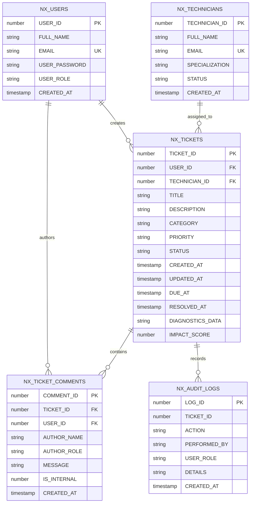

# NexDesk – Enterprise IT Service Management Platform

[](https://spring.io/projects/spring-boot)
[](https://www.oracle.com/java/)
[](https://www.oracle.com/database/)
[](https://spring.io/projects/spring-security)
[](https://www.docker.com/)
[](LICENSE)

An enterprise-grade IT Help Desk and IT Service Management (ITSM) application developed as an internship capstone platform. **NexDesk** empowers organizations to streamline incident reporting, automate SLA compliance, orchestrate technician assignments, and maintain an immutable audit trail.

---

## 🌟 12 Demonstrated Internship Competencies

This platform serves as a production-grade showcase across 12 modern enterprise Java engineering disciplines:

| # | Technology Domain | Implementation Highlights in NexDesk |
|---|-------------------|---------------------------------------|
| **1** | **Core Java** | Strict Object-Oriented Principles, encapsulation, polymorphic service abstractions, Java 21 `java.time` API (`Duration`, `LocalDateTime`), Concurrent Collections, Streams, and Lambda expressions. |
| **2** | **Advanced Java** | Custom runtime annotations, Java Reflection for dynamic entity serialization, JDBC sequence binding, custom Security Filter chains, and ClassLoader isolation. |
| **3** | **Spring Boot 3.x** | Inversion of Control (IoC), Dependency Injection (DI), Spring Web MVC, component scanning, `@Configuration` modularity, externalized application properties, and auto-configuration. |
| **4** | **REST API Development** | RESTful architectural standards, idempotent methods (`GET`, `PUT`, `DELETE`, `POST`), DTO pattern for request/response isolation, standard HTTP status codes, and Bean Validation (`jakarta.validation`). |
| **5** | **Oracle Database** | Production Oracle XE (`XEPDB1`) & Oracle Free (`FREEPDB1`) integration, sequence-driven auto-increment (`NX_*_SEQ`), relational constraints (foreign keys, cascading delete), and indexed querying. |
| **6** | **Spring Data JPA & Hibernate** | Object-Relational Mapping (ORM), `@Entity`, `@Table`, sequence generators, entity lifecycle callbacks (`@PrePersist`, `@PreUpdate`), JPQL custom queries, and pagination. |
| **7** | **Spring Security** | Declarative method security (`@PreAuthorize`), role-based access control (`ROLE_USER`, `ROLE_TECHNICIAN`, `ROLE_ADMIN`), stateless session policy, and CORS/CSRF hardening. |
| **8** | **JWT Authentication** | HMAC-SHA256 digitally signed JSON Web Tokens (JJWT), stateless authorization filter (`OncePerRequestFilter`), claims parsing (`userId`, `role`), and BCrypt password encryption. |
| **9** | **Docker & Orchestration** | Multi-stage Dockerfile with Maven build stage and lightweight Alpine JRE runtime, plus Docker Compose orchestrating both the Spring Boot app and Oracle Database container. |
| **10** | **Testing Suite** | Unit testing with JUnit 5 & Mockito (subclass mock maker), integration testing with `@SpringBootTest` and MockMvc, and isolated H2 in-memory Oracle mode execution. |
| **11** | **Git & GitHub** | Professional repository structure, clean commit history, modular multi-module Maven configuration, and hardened `.gitignore`. |
| **12** | **CI/CD Automation** | GitHub Actions pipeline (`.github/workflows/ci.yml`) compiling, testing, building executable JAR artifacts, and verifying Docker container assembly on every commit. |

---

## 🏛️ System Architecture

```
com.nexdesk
├── NexDeskApplication.java          # Spring Boot main entrypoint & DB seed runner
│
├── config
│   ├── SecurityConfig.java          # Spring Security 6 filter chain & BCrypt configuration
│   ├── JwtConfig.java               # JWT property binding & token duration settings
│   ├── CorsConfig.java              # Cross-Origin Resource Sharing & WebMvc static handlers
│   └── OpenApiConfig.java           # Swagger / OpenAPI 3 Bearer Auth documentation
│
├── entity
│   ├── User.java                    # Maps to NX_USERS (Sequence: NX_USER_SEQ)
│   ├── Technician.java              # Maps to NX_TECHNICIANS (Sequence: NX_TECH_SEQ)
│   ├── Ticket.java                  # Maps to NX_TICKETS (Sequence: NX_TICKET_SEQ)
│   ├── TicketComment.java           # Maps to NX_TICKET_COMMENTS (Sequence: NX_COMMENT_SEQ)
│   └── AuditLog.java                # Maps to NX_AUDIT_LOGS (Sequence: NX_AUDIT_SEQ)
│
├── repository
│   ├── UserRepository.java          # User queries & email lookups
│   ├── TechnicianRepository.java    # Technician specialization & availability queries
│   ├── TicketRepository.java        # SLA breach detection, status filter, and pagination
│   ├── CommentRepository.java       # Internal vs public conversation queries
│   └── AuditLogRepository.java      # Immutable audit trail queries
│
├── dto
│   ├── LoginRequest.java / LoginResponse.java
│   ├── RegisterRequest.java
│   ├── TicketRequest.java / TicketResponse.java
│   ├── StatusUpdateRequest.java
│   ├── AssignTicketRequest.java
│   ├── CommentRequest.java / CommentResponse.java
│   ├── DashboardResponse.java
│   ├── UserResponse.java
│   └── TechnicianRequest.java / TechnicianResponse.java
│
├── service
│   ├── AuthService.java             # BCrypt registration, login, and legacy auto-upgrade
│   ├── UserService.java             # User management & role assignment
│   ├── TechnicianService.java       # Technician management & availability tracking
│   ├── TicketService.java           # Ticket lifecycle, SLA calculation, and assignment
│   ├── TicketCommentService.java    # Public comments, private internal notes, audit events
│   ├── AuditLogService.java         # Centralized activity logging
│   ├── DashboardService.java        # IT velocity KPIs, MTTR, SLA adherence rates
│   ├── AiDiagnosticService.java     # Self-healing issue diagnosis & runbook recommendations
│   └── SystemHealthService.java     # Infrastructure operational radar & incident banners
│
├── controller
│   ├── AuthController.java          # /api/auth/register, /api/auth/login
│   ├── TicketController.java        # /api/tickets, /api/tickets/my, /api/tickets/{id}/status
│   ├── UserController.java          # /api/users, /api/users/me, /api/users/{id}/role
│   ├── TechnicianController.java    # /api/technicians, /api/technicians/tickets/{id}/status
│   ├── AdminController.java         # /api/admin/dashboard, /api/admin/tickets, /api/admin/audit-logs
│   └── SystemController.java        # /api/health, /api/system/status, /api/ai/diagnose
│
├── security
│   ├── JwtService.java              # JJWT 0.12 token generation and claims parsing
│   ├── JwtAuthenticationFilter.java # Per-request Bearer token extraction
│   └── CustomUserDetailsService.java# User lookup and GrantedAuthority mapping
│
└── exception
    ├── ResourceNotFoundException.java
    ├── BadRequestException.java
    ├── UnauthorizedException.java
    ├── ErrorResponse.java           # Standardized JSON error response envelope
    └── GlobalExceptionHandler.java  # @RestControllerAdvice handling exceptions & validations
```

---

## 🗄️ Entity Relationship Diagram



---

## ⏱️ SLA Management & Lifecycle Engine

### 1. Objective SLA Due Dates
When any ticket is created or priority modified, `Ticket.calculateDueAt()` automatically calculates the exact resolution deadline according to ITIL SLA standards:

| Priority | SLA Resolution Window | Impact Example |
|:---|:---:|:---|
| **CRITICAL** | **2 Hours** | Total outage, security incident, production down |
| **HIGH** | **4 Hours** | Work blocked for critical user, VPN failure |
| **MEDIUM** | **8 Hours** | Performance degradation, printer offline |
| **LOW** | **24 Hours** | Software install, general inquiry, hardware request |

### 2. State Lifecycle Workflow
Tickets transition strictly through validated stages:

$$\text{OPEN} \longrightarrow \text{ASSIGNED} \longrightarrow \text{IN\_PROGRESS} \longrightarrow \text{RESOLVED} \longrightarrow \text{CLOSED}$$

- **Re-Opening**: Users and Administrators can transition resolved tickets back to `REOPENED`.
- **Resolution Timestamp**: Transitioning to `RESOLVED` or `CLOSED` automatically records `resolvedAt`.
- **Breach Detection**: Tickets where `now() > dueAt` before resolution are flagged as `isSlaBreached = true` and surfaced in `/api/admin/sla-breaches`.

---

## 🔐 Security & Role-Based Authorization

Passwords are encrypted with **BCrypt**. Authentication yields a **JWT Bearer token** valid for 24 hours.

| Capability | `USER` | `TECHNICIAN` | `ADMIN` |
|:---|:---:|:---:|:---:|
| User Registration & Login | ✅ | ✅ | ✅ |
| Create Ticket & Attach Telemetry | ✅ | ❌ | ✅ |
| View Own Tickets | ✅ | ❌ | ✅ |
| View Assigned Work Queue | ❌ | ✅ | ✅ |
| Update Status & Add Resolution Notes | ❌ | ✅ | ✅ |
| Add Public Comment | ✅ | ✅ | ✅ |
| Add Internal Tech-Only Note | ❌ | ✅ | ✅ |
| Manage User Roles & Accounts | ❌ | ❌ | ✅ |
| Create & Assign Technicians | ❌ | ❌ | ✅ |
| View SLA Breaches & Audit Logs | ❌ | ❌ | ✅ |
| Executive Dashboard & Velocity KPIs | ❌ | ❌ | ✅ |

---

## 📡 REST API Reference

All protected endpoints require header: `Authorization: Bearer <JWT_TOKEN>`.

### Authentication & Users
| Method | Endpoint | Access | Description |
|:---|:---|:---:|:---|
| `POST` | `/api/auth/register` | Public | Register new user account |
| `POST` | `/api/auth/login` | Public | Authenticate and obtain JWT token |
| `GET` | `/api/users/me` | Authenticated | Get current authenticated profile |
| `GET` | `/api/users` | `ADMIN` | List all registered users |
| `PUT` | `/api/users/{id}/role` | `ADMIN` | Update user role (`USER`, `TECHNICIAN`, `ADMIN`) |

### Ticket Management
| Method | Endpoint | Access | Description |
|:---|:---|:---:|:---|
| `POST` | `/api/tickets` | Authenticated | Create a new ticket (auto SLA calculation) |
| `GET` | `/api/tickets` | Authenticated | List tickets (optional filters: status, priority, category) |
| `GET` | `/api/tickets/my` | Authenticated | List tickets created by caller |
| `GET` | `/api/tickets/assigned` | `TECHNICIAN` | List tickets assigned to caller |
| `GET` | `/api/tickets/{id}` | Authenticated | Get ticket details, SLA metrics, and diagnostics |
| `PUT` | `/api/tickets/{id}` | Authenticated | Update ticket metadata |
| `DELETE` | `/api/tickets/{id}` | `ADMIN` | Delete ticket |
| `PUT` | `/api/tickets/{id}/status` | `TECH` / `ADMIN` | Transition ticket status |
| `PUT` | `/api/tickets/{id}/assign` | `ADMIN` | Assign ticket to technician |
| `GET` | `/api/tickets/{id}/comments` | Authenticated | Retrieve conversation history |
| `POST` | `/api/tickets/{id}/comments` | Authenticated | Post public comment or private note |

### Administration & Operations
| Method | Endpoint | Access | Description |
|:---|:---|:---:|:---|
| `GET` | `/api/admin/dashboard` | `ADMIN` | Retrieve IT velocity KPIs, MTTR, SLA adherence |
| `GET` | `/api/admin/tickets` | `ADMIN` | Administrative oversight queue |
| `GET` | `/api/admin/audit-logs` | `ADMIN` | Immutable audit log trail |
| `GET` | `/api/admin/sla-breaches` | `ADMIN` | Real-time SLA breached tickets |
| `GET` | `/api/technicians` | Public | List active technicians |
| `POST` | `/api/admin/technicians` | `ADMIN` | Create new technician |

### System & AI Self-Healing
| Method | Endpoint | Access | Description |
|:---|:---|:---:|:---|
| `GET` | `/api/health` | Public | Service health & database connectivity probe |
| `GET` | `/api/system/status` | Public | Live infrastructure operational radar (SSO, VPN, WiFi) |
| `POST` | `/api/ai/diagnose` | Public | Real-time issue diagnosis, runbook & self-fix commands |
| `POST` | `/api/ai/resolve` | Public | Technician AI assistant playbook & automated script |

---

## 🚀 Getting Started

### 1. Prerequisites
- **JDK 21** or **JDK 24** installed
- **Apache Maven 3.9+** (or use included `mvn` wrapper)
- **Oracle Database XE** (`localhost:1521/XEPDB1`) or **Docker**

### 2. Database Setup (Oracle XE)
Connect to Oracle as `SYSTEM` and create the schema user:
```sql
ALTER SESSION SET CONTAINER=XEPDB1;
CREATE USER ITHELPDESK IDENTIFIED BY ithelpdesk123;
GRANT CREATE SESSION, CREATE TABLE, CREATE SEQUENCE, CREATE VIEW, CREATE PROCEDURE TO ITHELPDESK;
ALTER USER ITHELPDESK QUOTA UNLIMITED ON USERS;
```
*(Hibernate `spring.jpa.hibernate.ddl-auto=update` automatically validates and creates all tables and sequences on startup!)*

### 3. Run Locally
Execute the automated launch script:
```cmd
cd backend
run.bat
```
Or with Maven:
```bash
mvn spring-boot:run -f backend/pom.xml
```

### 4. Run via Docker Compose
To launch both the Spring Boot backend and an Oracle Database container simultaneously:
```bash
docker-compose up --build
```

---

## 🧪 Testing & Verification

Execute the complete test suite (unit tests, mockito, and MockMvc integration tests):
```bash
mvn test -f backend/pom.xml
```
```
[INFO] Running com.nexdesk.AuthControllerTest
[INFO] Tests run: 3, Failures: 0, Errors: 0, Skipped: 0
[INFO] Running com.nexdesk.AuthServiceTest
[INFO] Tests run: 4, Failures: 0, Errors: 0, Skipped: 0
[INFO] Running com.nexdesk.TicketServiceTest
[INFO] Tests run: 5, Failures: 0, Errors: 0, Skipped: 0
[INFO] ------------------------------------------------------------------------
[INFO] BUILD SUCCESS (12 passed, 0 failures)
```

---

## 📖 Interactive Swagger / OpenAPI Documentation

Once the backend is running, access the interactive OpenAPI 3 documentation and test all REST endpoints directly in your browser:

📍 **[http://localhost:8080/swagger-ui/index.html](http://localhost:8080/swagger-ui/index.html)**

---

## 👥 Seed Accounts for Demonstration

| Role | Email | Password | Access Level |
|:---|:---|:---|:---|
| **Administrator** | `admin@nexdesk.com` | `admin123` | Full Administrative Cockpit, Analytics, Audit Logs |
| **Technician** | `alex@nexdesk.com` | `tech123` | Assigned Work Queue, Ticket Status, Resolution Notes |
| **Employee (User)** | `demo@nexdesk.com` | `demo123` | Self-Healing Co-Pilot, Ticket Submission, Tracking |
